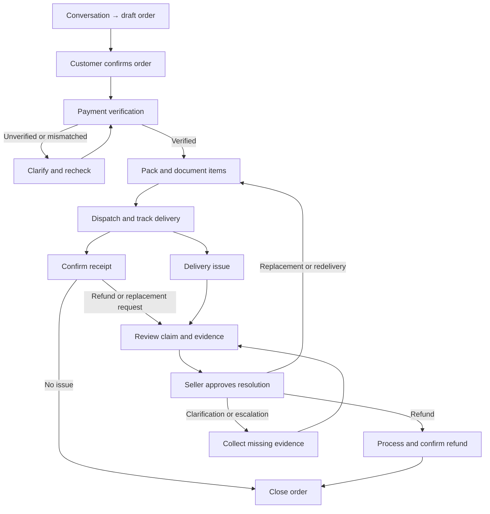

# Suri — End-to-End Product Requirements

Version 0.5 · 12 October 2026 · Hackathon MVP proposal

Product name is provisional. This is a new product-wide PRD covering conversation through resolution. Inputs are authorized chat messages, pasted text, and typed seller notes. Customer-call listening and post-call dictation remain outside scope. Optional seller narration is limited to deliberate packing-check sessions.

## 1. Problem statement

Small online sellers manage orders across Messenger conversations, payment services, packing activities, and delivery platforms. Because these records are disconnected, sellers struggle to verify payment claims, preserve changes to agreements, confirm what was packed, investigate missing or damaged deliveries, and assess refund requests fairly.

Manual checking takes time and can lead to lost goods, incorrect refunds, fulfillment mistakes, and disputes with legitimate customers. Sellers need a unified transaction record with clear evidence and actionable explanations before they ship, refund, or escalate.

## 2. Product proposition and USP

**An AI transaction-checking assistant for chat-based sellers that turns customer claims into evidence-backed checks before they ship or refund—even without an online storefront.**

The product connects what was said, ordered, paid, packed, and delivered. At each decision it shows what is claimed, what is verified, what is missing, and the next useful action.

Pitch: **Evidence-backed assistance from the first message to the final resolution.**

This is proposed differentiation, not a claim of market exclusivity. Conversation/order integration, fraud scoring, returns assessment, and dispute evidence compilation already exist in other products. Our focus is the complete claim-checking workflow for small sellers whose transactions begin in chat, including packaging evidence and a clear distinction between claims and verified records.

## 3. Users and goals

Primary user: a small seller or store employee handling chat-based orders. Initial pilot context: Philippine sellers using Messenger, a connected payment provider, and external delivery services. The workflow should support other regions and providers through adapters.

Customer benefit: accurate order confirmations, clear payment and delivery explanations, and fair handling of genuine issues.

Goals:

- Reduce repeated transcription and switching between disconnected records.
- Surface evidence gaps before consequential decisions.
- Preserve packing and delivery context for later review.
- Help distinguish operational mistakes, incomplete information, and possible abuse.
- Keep shipment and refund decisions under seller control.

## 4. End-to-end workflow

Diagram represents the main prepaid happy path and issue loop. Orders may be cancelled before dispatch. Issues can be opened at any stage, including payment or packing. A closed order may be reopened for a later claim. Replacement shipments preserve the original order and get a separate fulfillment record.

## 5. MVP scope

| Build for MVP | Defer |
| --- | --- |
| One store; role-based seller access | Cross-store reputation or blacklist |
| Messenger Page chat ingestion and pasted-text fallback | Broad marketplace integrations; Shopee delivery access under research |
| Structured order, confirmation, and version history | Full inventory/accounting platform |
| PayMongo sandbox: hosted QR Ph checkout, verified payment events, seller-approved refunds | Direct GCash/bank integration, proprietary payment rails, cash on delivery, mixed payments, installments |
| AI packing checks from photos/selected camera frames, with optional seller narration | Guaranteed verification of sealed contents; continuous video monitoring |
| Planned Lalamove sandbox integration: booking, status webhooks, tracking link, and available POD | Production delivery rollout and additional couriers |
| Claim review, source-linked timeline, seller-approved resolutions | Automatic fraud-based blocking or refunds |
| Explainable scam/fraud and operational pattern alerts using seeded store history | Validated predictive fraud models and cross-store intelligence |

Prepaid orders are the initial path. Support partial fulfillment through multiple shipment records only if necessary for the demonstration; otherwise state one shipment per original order in the interface.

## 6. Stage requirements

### 6.1 Conversation and draft order

Ingest authorized Page messages, seller-pasted text, or typed seller notes. Extract items, variants, quantities, prices, discounts, recipient, contact details, delivery instructions, and claims. Attach each field to its source. Ask clarification questions rather than inventing missing details.

Typed seller notes are labeled seller-reported and do not prove what another person said. Customer text is a claim unless supported by authoritative records. Match to an existing order with seller confirmation when ambiguous; never merge people solely by name or profile photo.

### 6.2 Customer confirmation

Generate a readable summary of items, total, fees, and address. Request an explicit confirmation through chat or a customer link. Capture the exact order version confirmed, source, and timestamp. A seller assertion of verbal agreement has a separate status from direct customer confirmation.

Changes to quantity, price, item, address, or payment instructions create a new version. Reopen affected checks and obtain confirmation before proceeding. Do not erase earlier agreements.

### 6.3 Payment verification

Create or associate a payment request with the confirmed order. Reconcile amount, currency, provider transaction ID, and order association against validated provider records. States: unpaid, pending, verified, failed, mismatched, verification unavailable, partially refunded, refunded.

The provider integration owns payment truth. AI explains discrepancies; screenshots and customer claims cannot set paid status. Validate webhook authenticity, deduplicate events, and prevent out-of-order events from regressing state. Show evidence freshness and separate test transactions from live transactions.

MVP dispatch gate requires the configured full prepaid amount to be verified, the relevant order version confirmed, and packing checks completed. Unavailable verification blocks normal dispatch. If a future product allows authorized exceptions, record them explicitly; never relabel an exception as verified payment.

#### PayMongo QR Ph payment integration — committed MVP path

Use PayMongo for payment acceptance, QR generation, confirmation, and eligible original-payment refunds. Our application orchestrates the order and interprets evidence; it does not build payment rails or collect banking credentials/OTPs. Start with one seller's PayMongo test account. Multi-merchant onboarding and payment aggregation are outside MVP.

Preferred time-limited implementation: backend creates a PayMongo Hosted Checkout Session with QR Ph enabled for the confirmed PHP order total and order reference; app sends the returned checkout URL through Messenger or the customer confirmation page. PayMongo's hosted page generates/displays the payment QR. Do not describe the checkout URL as a QR image. Current documentation recommends Checkout Sessions v2 for new integrations; validate sandbox behavior and the event payload before implementation.

If showing the QR inside our app becomes essential, use PayMongo's documented QR Ph Payment Intent/Payment Method flow to obtain the provider-generated QR rather than generating an independent payment QR. This is an alternative adapter, not a second required implementation. Keep hosted checkout as the MVP default.

- Store checkout/session, payment, order-reference, amount, currency, and order-version associations. Use integer centavos for amounts. Keep secret keys server-side and separate sandbox/live credentials.
- Verify the relevant signed successful-payment webhook and reconcile the actual payment record. Hosted Checkout uses checkout_session.payment.paid; subscribe only to events relevant to the implemented flow. The browser success redirect alone cannot mark an order paid.
- Handle pending/failed payments, expired QR codes, cancelled/replaced sessions, mismatched totals, duplicate callbacks, and unavailable verification. When order totals change, retire the obsolete payment request where supported and issue one for the newly confirmed version.
- Check payment state before issuing a replacement request. If two attempts succeed, record both and route overpayment to review rather than silently accepting it as a second order.
- PayMongo documents dynamic QR Ph as single-use with a default 30-minute expiry. Display actual provider expiry when available; do not assume the checkout session and QR expire simultaneously.
- Link each verified successful payment to the original provider payment ID so an eligible refund can be requested later.

PayMongo handles the payment channel, but merchant activation, QR Ph capability, account ownership, fees, and production requirements still apply. Demo scope is sandbox; production acceptance needs its own activation and controlled validation. Provider status establishes that payment succeeded, not that all surrounding transaction claims are legitimate.

### 6.4 Packaging evidence

Seller completes a line-item checklist and uploads photos showing items, quantity, condition, and parcel identifier where possible. AI compares visible details with the order and flags possible discrepancies. Seller resolves or acknowledges uncertain visual findings before marking packing complete.

Store upload time separately from claimed capture time; upload time does not prove when a photo was taken. Preserve original uploads and their hashes. These support record integrity, not physical chain of custody. Avoid unnecessary address-label exposure. Packaging photos do not conclusively prove that those items stayed in the sealed parcel.

#### Multimodal packing check

Seller opens a packing session for the current confirmed order, starts the camera or uploads photos, and optionally enables microphone narration. Capture is deliberate and visibly indicated; no customer-call audio or background listening. Photo upload and typed checklist remain available without microphone permission.

AI compares the expected checklist with visible observations and narrated claims. Checks may include item/variant, visible quantity, obvious surface damage, required accessories, protective packaging, and parcel/order-label association. Barcode or SKU scanning is a stronger identification aid where available; indistinguishable products, hidden contents, internal defects, and authenticity remain unverified.

Example: order expects two blue mugs; image shows one blue and one red mug; seller says “two blue mugs.” The assistant flags the variant conflict, shows the supporting frame and narration, and asks the seller to correct or inspect before sealing. Spoken quantities are claims, not proof that items are present. Avoid double-counting the same item across frames; request one laid-out overview for quantity checks.

Each line item has expected value, visually observed value, seller-reported value, source references, and result: matched, conflict, insufficient visibility, or seller-confirmed. Uncertainty never becomes an automatic pass. Seller resolves conflicts or records an explicit manual inspection with reason; AI cannot mark the package ready by itself. Show automated match separately from manual confirmation. Any order-version change invalidates affected packing checks.

For MVP, analyze still photos/selected frames and short narration clips rather than streaming continuous video. Narration can describe condition, counts, and protective steps; AI may suggest an additional close-up or angle. It cannot establish how the parcel was handled after capture.

Save approved packing evidence and checklist results. Audio and temporary transcript are discarded after review by default; verify external-provider retention before making that promise. Retained narrative is labeled seller-reported. Record session/order version and upload timestamps; hashes demonstrate file integrity, not uninterrupted chain of custody. If other people are audible, pause and address permission/privacy before capture resumes.

### 6.5 Dispatch and delivery

Create a fulfillment record with tracking reference, courier, dispatch time, and status events. Label each event as provider-supplied, seller-reported, customer-reported, or demo data. Track address changes and delivery exceptions. Preserve proof-of-delivery source and timestamps.

A delivered event is distinct from customer-confirmed receipt. Manual or simulated events must not be presented as live provider updates.

#### Planned Lalamove integration

- Start with Partner Portal sandbox credentials and the PH market configuration. Keep credentials server-side; sign HTTPS requests using the documented HMAC scheme.
- Obtain a quotation for the confirmed pickup/drop-off details and selected available service. Seller explicitly approves the delivery fee and booking. Define whether the fee is seller-paid or customer-paid; if it changes the customer total, reconfirm and reconcile payment before dispatch.
- Book only after confirmation, payment, and packing gates pass. Save the Lalamove order ID, quotation/price details, and returned tracking share link against the fulfillment record. Scope access to orders belonging to the connected account; do not promise lookup of arbitrary app-booked deliveries.
- Subscribe to documented order-status and driver-assignment events. Verify callback authenticity according to current documentation, acknowledge promptly, deduplicate, and handle out-of-order timestamps. Reconcile stale or missed updates through order retrieval with bounded retries respecting provider limits.
- Preserve raw provider status alongside normalized fulfillment state. A booking or driver match is not evidence of pickup. Validate the exact status mapping in sandbox before implementation.
- Request proof of delivery during booking where supported. Store available stop-level POD status, delivery time, and image/signature reference as provider evidence. Missing POD means unavailable evidence, not proof of a failed delivery.
- Show the returned tracking link first. Driver coordinates are optional enrichment: retrieve only during the documented availability window, respect limits, and display their last-update time. Do not promise continuous GPS tracking after completion.
- Handle expired quotations, rejected bookings, cancellations, unassigned drivers, missed callbacks, and uncertain booking responses. Reconcile an uncertain booking before retrying to avoid duplicate delivery orders; verify provider duplicate-prevention semantics.
- Customer acknowledgment remains separate from provider completion/POD. Neither proves the parcel contained the correct items.

Lalamove documents sandbox and production environments, wallet top-up for production credentials, status webhooks, share links, and POD requested at booking. Driver details are available during a defined active-order window; order retrieval is limited to orders created in the last 60 days. Specific PH service availability and sandbox simulations remain validation tasks. No production booking or spending is authorized by this PRD.

#### Shopee integration — open research, not committed MVP

Investigate Shopee Open Platform as an additional source for delivery events on an authorized seller's Shopee orders. Do not assume that Shopee logistics APIs can track unrelated Messenger/Lalamove orders or arbitrary tracking numbers. Preserve platform order IDs and rules separately from direct-sale orders; do not route Shopee checkout payments/refunds through PayMongo.

Research deliverables:

- Verify Philippine partner/app eligibility, approval requirements, seller authorization, scopes, and token lifecycle through current official documentation.
- Verify available order/logistics endpoints, shipment/package IDs, tracking events, supported notifications, and polling/rate limits. Endpoint names and webhook availability remain unconfirmed in this PRD.
- Determine whether POD images, driver identity/location, and delivery exception reasons are exposed; do not infer availability from Lalamove capabilities.
- Confirm test environment/access, permitted retention, platform terms, and access to orders created outside our app.
- Map source events into the evidence timeline without treating delivered status as customer acknowledgment.
- Produce an access feasibility matrix and a sample authorized payload before promoting the adapter into scope.

Until validated, retain Lalamove as the planned delivery integration and explicitly label any manually imported Shopee tracking information. No scraping or unsupported account access is part of this plan.

### 6.6 Customer receipt and claims

Request customer acknowledgment. Without acknowledgment, retain delivered/unconfirmed status rather than inventing receipt. Open a claim for missing item, wrong item, damage, nonreceipt, payment issue, cancellation, or another explanation.

AI structures the narrative, links the relevant order/shipment, and requests necessary photos, references, or clarification. Missing evidence produces an incomplete case, not an automatic finding of fraud.

### 6.7 Evidence review and resolution

Build a case view comparing the claim with confirmed order versions, messages, payment records, packing evidence, delivery events, and applicable policy. Use four findings: supported, conflicting, unverified, insufficient data. Each finding has citations and uncertainty.

Recommend clarification, refund, partial refund, replacement, redelivery, or escalation, with an explanation. Seller approves the outcome and customer communication. No global scam score or identity label.

Pattern analysis shows denominators and relevant context: for example, damage claims per delivered order, grouped by product, customer, or courier. Small samples are labeled. A frequently assigned rider naturally has more claims; counts alone cannot establish abuse. For MVP use synthetic history to demonstrate this behavior, not to claim validated fraud-detection accuracy.

### 6.7a Scam, fraud, and delivery-issue pattern analysis

This is a dedicated feature spanning the order lifecycle. Its purpose is to surface related incidents and operational concentrations for investigation, not to establish intent or label a person a scammer. Store-scoped history informs payment review, packing review, and claim resolution; every new incident and correction can update relevant patterns.

| Pattern family | Signals and supporting records | Suggested investigation |
| --- | --- | --- |
| Payment discrepancies | A payment reference or receipt image reused across distinct orders; repeated unmatched payment claims | Verify provider transaction/order allocation; account for legitimate combined payments |
| Conversation risk | Repeated requests to ship before payment verification, inconsistent instructions, or refund destination changes | Clarify the specific claim and confirm instructions in writing |
| Refund/claim recurrence | Missing-item, replacement, nonreceipt, or damage claims linked to the same reliably identified customer | Compare individual cases and outcomes; do not refuse genuine claims solely because of history |
| Delivery issues | Concentrated loss/damage reports by courier or identifiable delivery personnel | Compare delivery evidence, assignment volume, product mix, and packing quality |
| Product/packing issues | Concentrated claims by SKU, variant, packing method, or identified packer | Inspect stock quality, fragile-product handling, and packing procedures |

#### Pattern computation and AI role

Use deterministic aggregation for counts, rates, reference reuse, and exact image hashes. AI classifies narratives into reviewed issue categories, summarizes similarities/differences, and proposes questions with source citations. Similar-image matching is a candidate signal, not proof of forgery; preserve similarity-method provenance. Do not let the model invent linked cases or calculate unverified statistics.

MVP covers three explainable scenarios: payment-reference reuse, recurring customer claims, and delivery/product damage concentration. Include ordinary counterexamples: one payment intentionally covering two orders, a high-volume courier, and a defective product affecting multiple customers. Demonstrate other conversation/packing patterns only if extraction quality supports them.

Use a selectable time window (default 30 days). Define the denominator for each metric: payment-claim incidents per eligible order, customer claims per fulfilled order, and damage/nonreceipt reports per delivered shipment. Deduplicate repeated reports of the same incident; separate replacements and repeat shipments. Show numerator, denominator, coverage, unresolved/resolved outcomes, and comparator population. Display claim occurrence separately from confirmed error/abuse findings. Compare comparable product/courier cohorts when possible; describe missing product or assignment data.

Thresholds are configurable review heuristics, not calibrated fraud probabilities. Small samples get an insufficient-history label; the minimum sample policy is selected through evaluation. Direct reuse checks may still raise a specific verification task with few cases, but must not imply a statistically elevated rate. Do not present rate comparisons as statistically significant without an appropriate analysis.

#### Finding card and review lifecycle

Every card includes: pattern type, entity/identifier confidence, timeframe, linked orders/shipments, source citations, counts/rates, comparison baseline, data completeness, alternative explanations, and recommended review. Statuses: new, reviewing, explained operationally, unresolved, dismissed, or superseded. Separate the alert decision from individual claim outcomes. Seller records reasons, and corrected records trigger recomputation.

Example: “4 damage claims across 20 deliveries assigned to this rider in the last 30 days; store-wide 6 across 100. Three affected parcels contain the same fragile product. Review packaging and delivery evidence.” This is a descriptive concentration, not proof the rider caused the damage; review comparable product assignments before drawing conclusions.

Pattern alerts do not automatically block dispatch, deny refunds, cancel bookings, or blacklist anyone. Payment verification and order-confirmation gates still apply independently.

#### Identity and availability constraints

Scope associations to stable authorized identifiers: Page-scoped customer ID within that Page, product SKU, fulfillment ID, and provider driver ID where reliably available. Names, photos, shared addresses, phone numbers, or repeated wording alone do not establish identity. Different people may share identifiers; avoid merging without review. Driver reassignment must be recorded: assignment does not prove who handled the parcel when damage occurred. Missing rider identity disables rider-level aggregation; courier/product summaries remain possible.

Do not promise access to Facebook account age, group reports, cross-store histories, or Shopee driver identities. Lalamove driver-level data and historical retention must be validated. Preserve only necessary authorized identifiers and appropriate evidence, with access and retention controls.

### 6.8 Execute and close

Refund execution is a separate, explicit seller action after approval. Validate provider support, original transaction, remaining refundable balance, and idempotency. If the provider cannot refund the payment, show a manual resolution workflow; do not promise arbitrary wallet payouts.

Refund states include requested, submitted, pending, succeeded, failed, and cancelled where supported. Close the case only after the chosen outcome is confirmed. A replacement creates a linked shipment with its own packing/delivery evidence, not an overwrite of the original. Escalated cases stay open with an owner and next action.

#### PayMongo refund integration — committed MVP path

After reviewing a case, seller selects an eligible PayMongo payment, full or partial amount, and refund reason. Show the approved case outcome, payment ID, remaining refundable amount, and applicable method/time-window constraints. A separate explicit confirmation submits the refund through PayMongo. AI may prepare the recommendation but cannot initiate money movement.

Use the original successful payment's refund mechanism. It is not a payout to an arbitrary GCash number or bank account, and it cannot refund a payment made outside the connected PayMongo account. Do not collect alternate wallet details to bypass an unsupported refund.

Current PayMongo documentation lists QR Ph refunds through API/Dashboard, a 30-day refund window, and partial-refund support. Other methods have different restrictions. Validate the chosen method in sandbox and refresh these rules before production; do not promise a universal refund deadline or instant settlement.

- Use the documented Refund API with original payment ID, integer amount, and required reason; retain provider refund ID and the seller decision audit record.
- Keep approved, submitted, pending, succeeded, and failed states separate. Process applicable payment.refund.updated/payment.refunded events and reconcile the refund object. API acceptance is not proof funds reached the buyer.
- Enforce remaining refundable balance, including pending submissions and previous partial refunds. Lock concurrent submissions and implement an internal operation ID. Verify provider idempotency support; reconcile uncertain responses before retrying.
- Show failures and retry/escalation options. If API refund access is blocked, allow a seller-operated PayMongo Dashboard refund, then reconcile the provider result; do not claim API completion.
- For expired/ineligible refunds or unavailable methods, show a documented manual resolution requiring seller review. Never label a manually reported transfer as provider-verified refund success.
- Test full and partial refund handling where supported, duplicate requests, out-of-order events, timeouts, and insufficient eligibility. Seeded outcomes must be labeled if sandbox cannot exercise them.

## 7. AI use cases

1. Conversation-to-order extraction with clarification and source references.
2. Payment claim reconciliation and plain-language mismatch explanations.
3. Conversation risk detection: conflicting claims, altered payment instructions, delivery changes, or pressure to ship before verification.
4. Multimodal packing assistance: compare visible items, quantities, condition, packaging, and optional seller narration against the confirmed order; surface conflicts and request additional views.
5. Refund and delivery assessment across messages, packing photos, tracking, and claims.
6. Scam/fraud and delivery-issue pattern analysis: detect payment-reference reuse, recurring claims, conversation-risk repetition, and courier/product/packing concentrations with evidence, denominators, and alternative explanations.
7. Source-linked case timelines and dispute summaries.
8. Policy-grounded resolution suggestions and draft replies.

Use deterministic logic for payment balances, state transitions, permissions, and execution gates. Use generative AI for extraction, evidence synthesis, clarification, and explanations. Customer text and documents are untrusted data and cannot authorize actions or override instructions.

## 8. Interface and information architecture

Main screen: order list with stage, amount, payment status, fulfillment status, and next action. Order detail: stage tracker, current order version, evidence timeline, missing-information checklist, and action panel. Claims open a focused review view without losing the original lifecycle context. A Patterns view lists evidence-backed alerts with filters by time, pattern type, and review status; relevant cards also appear on individual orders and claims.

Every significant fact shows source, timestamp, and evidence status. Display recommendations as editable drafts. Prefer specific notices such as “Verify the payment reference before dispatch” over “Suspicious customer.” Test/demo badges appear on all synthetic or sandbox records.

## 9. State and data model

Avoid one overloaded order status. Maintain linked state machines:

| Entity | Core states/data |
| --- | --- |
| Order / OrderVersion | Draft, awaiting confirmation, confirmed, cancelled; line items, totals, version |
| Payment | Provider ID, amount/currency, verification status, freshness, refund balance |
| Fulfillment | Packing, ready, dispatched, delivery exception, delivered; parcel/tracking references |
| Receipt | Unconfirmed or customer-confirmed; source and timestamp |
| Claim | Open, awaiting evidence, under review, resolution approved, executing, resolved, escalated |
| Evidence | Tenant/order linkage, source type, original reference, content hash, timestamps, verification status |
| AI insight | Claim/decision, evidence IDs, model version, current/superseded state |
| PatternFinding / Review | Rule/version, time window, entity IDs, incident IDs, numerator/denominator, baseline, completeness, citations, review state and reason |
| Decision / Resolution | Approver, approved order version, action, reason, execution ID and status |

Support cancellation, reopening, and retry without deleting historical states. Freshness-sensitive decisions use the latest authoritative record, while retaining the decision-time snapshot for audit.

## 10. Architecture and integrations

Web frontend → authenticated backend → provider adapters and append-only evidence events → normalized transaction records → AI extraction/reasoning → reviewable insights and seller-controlled actions.

Suggested initial adapters: Messenger Page, PayMongo hosted QR Ph checkout/refund sandbox, file uploads, optional packing-camera/microphone input, and Lalamove sandbox. Keep provider-specific facts separate from normalized domain states. Page message access requires the appropriate Meta configuration and permissions. Lalamove access and Philippine-market service coverage must be tested before claiming a working integration.

New events trigger reanalysis of affected findings. Validate schema-constrained AI output and citation references before display. Deduplicate jobs and provider callbacks. Authorization filters evidence before sending it to a model. Keep secrets server-side and enforce store isolation on every read and mutation.

## 11. Privacy and data handling

Customer-call listening and post-call dictation are excluded. Optional packing narration uses an explicit seller-started session, microphone permission, visible start/stop controls, and transient audio processing. No ambient/background capture. Typed and narrated notes remain seller-reported. Disable capture when permissions are revoked and release devices on stop.

Order addresses, customer contact details, driver information, and delivery photos remain personal information. Limit staff access, protect data in transit/storage, mask general logs, define retention/deletion policies, and avoid unnecessary collection. Disclose relevant sharing with payment, delivery, and AI providers. Verify provider retention separately.

Use driver location only for the active shipment and show its last-update time. Do not use location for off-duty monitoring. Treat a tracking share link as sensitive: Lalamove documents that it can be viewed without login. Restrict its exposure to authorized staff and the relevant customer. Do not assume POD URLs remain accessible indefinitely; define permitted evidence retention and handle unavailable images explicitly.

## 12. Failure and exception handling

| Failure | Expected behavior |
| --- | --- |
| Missing or uncertain extraction | Ask for clarification; keep draft |
| Duplicate/out-of-order webhook | Idempotent processing; preserve correct provider state |
| Payment provider unavailable | Verification unavailable; normal dispatch remains blocked |
| Packing image unclear | Request seller inspection; do not assert contents |
| Delivery integration absent | Manual/demo badge; no live-tracking claim |
| Customer reports nonreceipt despite delivery event | Open investigation; preserve both sources |
| AI output lacks valid sources | Withhold unsupported finding; show insufficient data |
| Refund submission times out | Check original operation before retry; prevent duplicate payout |
| User changes order after confirmation | New version and revalidation of affected gates |
| Lalamove access unavailable or callback missing | Show stale/unavailable status; reconcile using order retrieval; use labeled manual/demo fallback |

## 13. Acceptance criteria and evaluation

- Complete a prepaid order from chat to customer-confirmed receipt with a traceable record at every stage.
- Reject dispatch attempts when payment is pending/unavailable or the current order version is unconfirmed.
- A receipt screenshot or success redirect never overrides authoritative payment status.
- Create a PayMongo sandbox QR Ph checkout tied to the confirmed order version; verify signed payment success and duplicate-event handling.
- Replaced payment attempts and unexpected duplicate payments remain traceable and cannot silently mark another order paid.
- Submit an approved eligible sandbox refund, track provider status, and prevent duplicate/concurrent refunds or excess amounts; report simulated/unavailable test cases explicitly.
- Packing discrepancies produce a review task, and replacement fulfillment preserves the original evidence.
- Packing checks distinguish observed facts from spoken claims; missing microphone permission does not block photo/manual packing.
- Evaluate at least 12 packing cases covering correct items, wrong variant, missing quantity, visible damage, occlusion, repeated frames, contradictory narration, and noise. Report false matches and missed conflicts.
- Stopping packing capture releases camera/microphone; no new media is transmitted afterward. Current order-version checks and seller approval are required before readiness.
- Late delivery updates and corrected messages supersede outdated insights without erasing history.
- Every case-summary fact has a valid source or is explicitly marked seller-reported/unknown.
- No refund, shipment, or order change executes solely because AI recommends it.
- Duplicate callbacks and refund retries do not duplicate money movement.
- Verify access isolation, source provenance, and message/document prompt-injection resistance.
- Demonstrate a later claim reopening a closed order, and a legitimate complaint resolved fairly.
- Seeded pattern counts and denominators match independently checked fixtures; duplicate incident reports do not inflate rates.
- Reference reuse is distinguished from an explicitly allocated combined payment; high-volume courier counts alone do not trigger an elevated-rate claim.
- Missing rider identifiers and insufficient history produce explicit limitations, not inferred identities or fabricated rates.
- Every pattern card links its cases, shows alternative explanations, and requires review; alerts never automatically reject a claim.
- Dismissed/corrected cases cause recomputation and supersede stale cards; tenant history cannot leak across stores.
- Link a Lalamove sandbox booking to exactly one fulfillment; ingest duplicate and out-of-order callbacks without duplicating milestones.
- Preserve provider statuses, POD source, timestamps, and test labels; never convert completion into customer acknowledgment.
- Expired quotations and uncertain booking responses require reconciliation before a new booking attempt.
- If sandbox cannot exercise a delivery milestone, label the replayed event as simulated and report the untested behavior.

Initial AI evaluation: 20 synthetic cases, split between ordinary requests and seeded discrepancies. Measure structured-field accuracy, discrepancy detection, unsupported-warning rate, citation validity, seller corrections, and time to decision. Include negation, changing agreements, repeated references, low-quality photos, and missing provider data. Report the sample size and actual results; this is workflow validation, not a production fraud-rate estimate.

## 14. Hackathon demonstration

Use synthetic customers and test accounts. Mark payment/delivery sandbox records and simulated transitions visibly.

1. Customer chat becomes a draft order; customer confirms it.
2. Customer submits a payment claim; app shows no matching verified payment.
3. Customer opens PayMongo hosted QR Ph checkout; a genuine sandbox success event arrives and the order advances. Test checkout is not a real bank/e-wallet transfer.
4. Packing image and optional seller narration conflict with the expected item/quantity; AI cites the discrepancy and seller corrects it before sealing.
5. Lalamove sandbox booking/status data enters the timeline; show available tracking/POD and a customer missing-item report. Label any simulated driver movement or POD.
6. AI compares the claim with packing/delivery records, distinguishes uncertainty, and recommends a clarification or appropriate remedy.
7. Seller opens a related pattern card from seeded history: repeated damage reports cluster around a fragile product and courier. Show volumes and competing explanations.
8. Seller approves a resolution; refund completion or replacement tracking updates the timeline.

Keep the video under the competition limit. Show one complete story with brief stage transitions; use a second short example only if needed to demonstrate fair handling of a legitimate claim. Chat, multimodal packing checks, and transaction evidence demonstrate the workflow; customer-call audio is excluded.

## 15. Delivery priorities

P0: data/state model, draft order and confirmation, PayMongo hosted QR Ph checkout and verified sandbox payment, stage gates, evidence timeline, packing checklist, Lalamove sandbox access/quotation/booking/status webhook integration, claim review, seller approvals.

P1: packaging vision with optional seller narration, Lalamove tracking/POD presentation, PayMongo seller-approved refund execution in sandbox, source-linked summaries, three seeded pattern scenarios and their legitimate counterexamples, evaluation fixtures.

P2: Lalamove production rollout after validation, production validation/tuning of pattern alerts, additional channels and couriers; Shopee adapter only after access research succeeds.

Success gate: ship a reliable complete lifecycle before adding more integrations. Establish baseline manual handling time and measure assisted handling on the same cases. Useful outcomes are faster reviews, fewer unsupported actions, and accurate records—not the number of customers labeled suspicious.

## 16. Open decisions

- Confirm first store/channel and permitted Messenger testing setup.
- Select AI providers after checking cost, language performance, and retention.
- Validate PayMongo Checkout Sessions v2 QR Ph capability, signed success events, original payment IDs, and full/partial refund behavior in sandbox.
- Confirm production merchant activation, enabled capabilities, pricing, refund rules, and requirements separately; direct payment-provider integrations are deferred.
- Decide whether customer confirmation uses chat replies or a signed session link.
- Validate Lalamove sandbox credentials, PH service coverage, POD behavior, and simulated status transitions; retain a labeled fallback until verified.
- Define production retention, access roles, and jurisdiction-specific privacy notices.
- Complete Shopee Open Platform access/logistics feasibility research; do not promise live integration before authorization and payload validation.
- Select packing vision and speech providers; evaluate noisy workspaces, code-switching, visually similar variants, and hidden items.
- Validate stable customer/rider identifiers, incident taxonomy, denominator definitions, minimum history, and review thresholds before using pattern alerts on live data.

## 17. Reference context

These sources informed prior discussion; verify current provider capabilities during implementation. Product scope above is proposed, not a promise of provider support.

- PayMongo scam guide: https://www.paymongo.com/en-ph/blog/how-to-prevent-payment-scams-philippines
- PayMongo webhook setup: https://docs.paymongo.com/docs/developer-tools-webhook-setup-management
- PayMongo webhook events: https://docs.paymongo.com/docs/developer-tools-webhooks-events
- PayMongo Hosted Checkout: https://docs.paymongo.com/docs/payment-channels-hosted-checkout
- PayMongo Hosted Checkout quick start: https://docs.paymongo.com/docs/payment-channels-hosted-checkout-quick-start
- PayMongo QR Ph: https://docs.paymongo.com/docs/payment-acceptance-qr-ph
- PayMongo QR Ph API (alternative): https://docs.paymongo.com/docs/payment-acceptance-qr-ph-api
- PayMongo refund rules: https://docs.paymongo.com/docs/payment-acceptance-refunds
- Meta Messenger API collection: https://www.postman.com/meta/messenger-platform-api/collection/iyp204x/messenger-platform-api
- Lalamove API reference: https://developers.lalamove.com/
- Lalamove Philippines API solutions: https://www.lalamove.com/en-ph/business/api-solutions
- Gorgias AI agent: https://docs.gorgias.com/en-US/ai-agent-explained-497772
- Signifyd returns assessment: https://www.signifyd.com/returns-assurance/
- Chargeflow ecommerce evidence: https://www.chargeflow.io/ecommerce
- Shopee Open Platform (research starting point): https://open.shopee.com/

